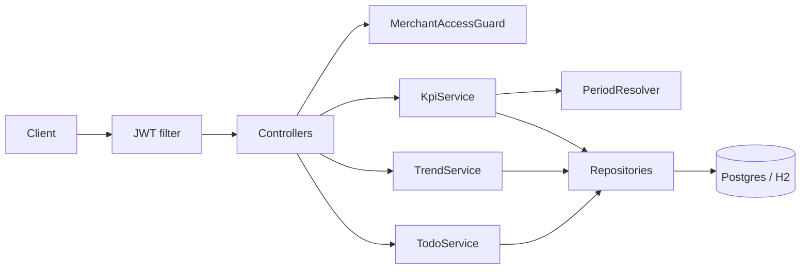
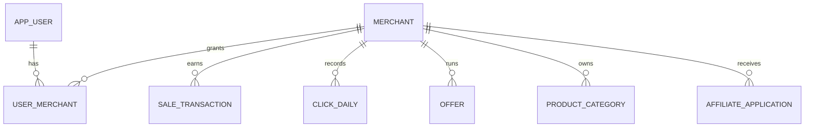

# EPIC: Merchant Dashboard Backend API

Secured REST backend (Java 25, Spring Boot 4, Flyway, Postgres; H2 in tests using the same Flyway scripts) powering the Awin merchant dashboard. Each KPI/widget takes its own time period.

## What the dashboard needs (API surface)

- Merchant switcher ("Example Merchant (1001)") -> list merchants the user can access.
- 3 KPI cards (Revenue, Transactions, Clicks): each has its own period dropdown, a date range label, the current value and a % change vs the previous equivalent period.
- Revenue trend: its own period ("Last Month"), total + % change, and two daily series (current vs previous period, e.g. Dec 1-31 vs Nov 1-30).
- To-do list: 4 counters (expired offers, product categories to map, commissions to validate, applications to review).

## Stack

- Java 25, built with Gradle Kotlin DSL, on Spring Boot 4.
- Spring Web, Jakarta Bean Validation, Spring Data JPA.
- Spring Security: OAuth2 resource server, HMAC JWT, BCrypt password hashes.
- Flyway for schema. PostgreSQL for local (Docker Compose) and production. H2 in PostgreSQL mode for tests.
- OpenAPI 3.1. The OpenAPI Generator Gradle plugin (`spring`, delegate pattern, Jakarta) generates the controllers.
- RFC 7807 `ProblemDetail` for errors.
- Spotless for Java and `*.gradle.kts`.
- JUnit 5 and MockMvc, from `spring-boot-starter-test`. Instancio creates test objects.
- JaCoCo. Hand-written `src/main` line coverage stays at or above 90%. `build/generated` is excluded. `check` fails below that.
- JSON logs from the start, with a Micrometer trace id on each line. Actuator health on the main app.
- Prometheus (Micrometer registry plus a Prometheus server in Compose) is added last, after the endpoints exist.

Testcontainers and a trace backend are later options, not part of this stack. JDBC is not used.

## Assumptions

- Build tool: Gradle Kotlin DSL (`build.gradle.kts`). Java toolchain 25. JDK 25 is required (this machine currently has JDK 21). Spring Boot 4.
- Security: stateless JWT via Spring Security (`oauth2-resource-server`, HMAC-signed). `POST /api/v1/auth/token` (username/password, BCrypt) issues tokens for dev and tests. Replaceable by an external IdP later via issuer/JWK config.
- Authorization: a user may only read merchants they are linked to (403 otherwise), so merchant data is isolated per tenant.
- Period model: `LAST_7_DAYS`, `LAST_30_DAYS`, `LAST_90_DAYS`, `LAST_MONTH` (previous calendar month), `THIS_MONTH`. The range ends yesterday (inclusive), evaluated in UTC with an injectable `Clock`. The comparison range is the immediately preceding window of equal length (for `LAST_MONTH`, the month before). % change = (current - previous) / previous, and `null` when previous is 0.
- Data comes from seeded local tables (no external Awin integration). Currency is stored per merchant, GBP in seed data.

## API design

All under `/api/v1`, all require a Bearer token except auth.

- `POST /auth/token`
- `GET /merchants` (the user's accessible merchants)
- `GET /merchants/{merchantId}/kpis/revenue?period=LAST_90_DAYS`
- `GET /merchants/{merchantId}/kpis/transactions?period=...`
- `GET /merchants/{merchantId}/kpis/clicks?period=...`
- `GET /merchants/{merchantId}/revenue-trend?period=LAST_MONTH`
- `GET /merchants/{merchantId}/todos`

KPI response:

```json
{ "metric": "REVENUE", "period": "LAST_90_DAYS", "from": "2026-10-14", "to": "2027-01-11",
  "value": 1086.30, "previousValue": 2404.1, "changePercent": -54.88, "currency": "GBP" }
```

Trend response: `{ period, total, changePercent, currency, current:[{date,value}], previous:[{date,value}] }`, zero-filled so the chart has a continuous x-axis.

Each KPI is its own endpoint and service, so Revenue can be requested for a month and Transactions for 90 days independently. Errors use RFC 7807 `ProblemDetail` (400 invalid period, 401, 403, 404).

**Contract.** `src/main/resources/openapi/openapi.yaml` (OpenAPI 3.1) is the source of truth, including the bearer scheme and `application/problem+json` errors. The OpenAPI Generator Gradle plugin (`spring` generator, `delegatePattern`, Jakarta) generates models, `*ApiController`, and `*ApiDelegate` into `build/generated`. Hand-written code implements the delegates only. During T1, confirm the generator release supports Spring Boot 4.

## Architecture



Hand-written packages under `com.awin.merchantdashboard`. Each domain owns its `model`, `repository`, `service`, and `controller`. A delegate implements the generated `*ApiDelegate` and lives in that domain's `controller` package.

```
com.awin.merchantdashboard
  config/                         SecurityFilterChain, CORS, ProblemDetail, Flyway, logging
  period/                         Period, PeriodResolver, PercentageChange
  auth/
    model/                        AppUser
    repository/                   AppUserRepository
    service/                      login and token issuance
    controller/                   POST /auth/token delegate
  merchant/
    model/                        Merchant, UserMerchant, UserMerchantId
    repository/                   MerchantRepository, UserMerchantRepository
    service/                      merchant list, MerchantAccessGuard
    controller/                   GET /merchants delegate
  kpi/
    model/                        SaleTransaction, SaleStatus, ClickDaily, ClickDailyId
    repository/                   SaleTransactionRepository, ClickDailyRepository
    service/                      revenue, transactions, clicks
    controller/                   the three KPI delegates
  trend/
    service/                      revenue trend
    controller/                   revenue-trend delegate
  todo/
    model/                        Offer, OfferStatus, ProductCategory, AffiliateApplication, ApplicationStatus
    repository/                   OfferRepository, ProductCategoryRepository, AffiliateApplicationRepository
    service/                      the four counters
    controller/                   todos delegate
```

`period` has no repository or controller. `trend` has no table of its own, so it has only `service` and `controller`.

`SaleTransaction` and `ClickDaily` live in `kpi`. `trend.service` and the pending-sale count in `todo.service` call `kpi.repository.SaleTransactionRepository`. `MerchantAccessGuard` lives in `merchant.service`. Merchant-scoped controllers in `kpi`, `trend`, and `todo` call it before reading data.

Generated API types stay in `build/generated` (`com.awin.merchantdashboard.api` and `com.awin.merchantdashboard.api.model`) and are not edited.

## Data model

Flyway scripts in `src/main/resources/db/migration`, ANSI SQL so the same scripts run on Postgres and on H2 in PostgreSQL mode.

### Scope rule

A column exists only if the dashboard reads it or the API needs it to compute what the dashboard reads. No audit columns, no display names, no per-publisher breakdowns. KPIs, the trend and the to-do counters are computed by queries, so there is no `kpi` or `todo` table.

### Entities

| Entity | Table | Columns | Why each column exists |
| --- | --- | --- | --- |
| Merchant | `merchant` | `id` (assigned, e.g. 1001), `name`, `currency` (ISO 4217) | The switcher shows "Example Merchant (1001)". `currency` produces the £ symbol on Revenue and the trend. |
| AppUser | `app_user` | `id`, `username` (unique), `password_hash` (BCrypt) | Login only. The dashboard never renders a user, so there is no display name or enabled flag. |
| UserMerchant | `user_merchant` | `user_id` (FK to `app_user.id`), `merchant_id` (FK to `merchant.id`). Composite primary key. | The link between a login and a merchant. Decides which merchants appear in the switcher and which return 403. No role: the screen has no permission distinction. |
| SaleTransaction | `sale_transaction` | `id`, `merchant_id`, `transaction_date`, `sale_amount`, `status` (PENDING, APPROVED, DECLINED) | Revenue and the trend sum `sale_amount`. Transactions counts rows. "Validate commissions" counts PENDING rows, so the commission is the transaction itself and there is no commission amount or commission table. DECLINED rows are excluded from Revenue and Transactions. |
| ClickDaily | `click_daily` | `merchant_id`, `click_date`, `click_count`. Unique on `(merchant_id, click_date)` | The Clicks card is one number per merchant per day. There is no publisher split because the screen never shows one. |
| Offer | `offer` | `id`, `merchant_id`, `expires_at`, `status` (ACTIVE, REMOVED) | "Remove expired offers" = ACTIVE rows with `expires_at` before now. No title or start date: the screen shows a count. |
| ProductCategory | `product_category` | `id`, `merchant_id`, `mapped` (boolean) | "Map product categories" = rows where `mapped` is false. No category name: the screen shows a count. |
| AffiliateApplication | `affiliate_application` | `id`, `merchant_id`, `status` (PENDING, REVIEWED) | "Review applications" counts rows with `status = 'PENDING'`. No applicant column. See below. |

There is no `publisher` entity. Nothing on the screen names an affiliate.

**Why an application has no affiliate.** The card shows one number, "Review 1,189 applications". The query is `count(*)` for that merchant where `status = 'PENDING'`. A row is one application, so 1,189 pending rows produce 1,189. Who submitted it does not change the number, and the response never returns a name.

The applicant would be a publisher, which is a different account from `app_user`. `app_user` is a person who logs into this dashboard. A publisher is an affiliate asking to join the merchant's programme. This service has no publisher table, so an applicant id would point at nothing and could not be returned.

A full programme would store that publisher and a unique `(merchant_id, publisher_id)`, so the same affiliate cannot apply twice. This dashboard does not show that queue and does not enforce that rule. `merchant_id` and `status` are the columns the count needs.

### Relationships



Every row except `app_user` belongs to exactly one merchant through a mandatory `merchant_id`. That column is the tenant boundary for every query. Nothing relates offers, categories or applications to each other or to sales.

### Business logic

Shared by every merchant call except login: invalid or missing token is 401. Unknown `merchantId` is 404. A known merchant with no `user_merchant` row for the caller is 403. An unknown `period` is 400.

`changePercent` is `(current - previous) / previous * 100`, scale 2, half up. It is null when `previous` is 0. Dates are UTC. "Today" comes from an injectable `Clock`. A rolling window ends yesterday, inclusive. `LAST_7_DAYS`, `LAST_30_DAYS`, and `LAST_90_DAYS` are that many days. `LAST_MONTH` is the previous calendar month, compared with the month before it. `THIS_MONTH` runs from the 1st through yesterday. On the 1st that window is empty and the value is 0. Its previous window is the same number of days immediately before the 1st.

- **Login.** `POST /auth/token` checks `username` and a BCrypt `password_hash`. Unknown user and wrong password both return 401. Success returns an HMAC JWT whose subject is `app_user.id`, expiring in 1 hour. No refresh token.
- **Merchants.** `GET /merchants` returns `id`, `name`, and `currency` for rows linked to the caller, ordered by `name`, then `id`. No rows is 200 and an empty list.
- **Revenue.** Sum of `sale_amount` for `PENDING` and `APPROVED` sales whose UTC date falls in the window. `DECLINED` is excluded. The response includes `previousValue`, `changePercent`, the inclusive `from` and `to`, and the merchant `currency`. The sum uses scale 2, half up.
- **Transactions.** Count of those same sales. The value is an integer. No `currency`.
- **Clicks.** Sum of `click_count` for `click_date` in the window. A missing day counts as 0. The value is an integer. No `currency`.
- **Revenue trend.** Same revenue rule, one point per day, ordered by date. Days with no sales are 0. `current` covers the requested window. `previous` covers the comparison window, also zero-filled. `total` is the sum of `current`. `changePercent` compares the two totals. `currency` comes from the merchant.
- **To-do.** No period. One response with four counts: `ACTIVE` offers with `expires_at` before now, categories with `mapped = false`, `PENDING` sales, and `PENDING` applications. Pending sales are `count(*)` for that merchant where `status = 'PENDING'`, using `sale_transaction_pending_idx` on `(merchant_id)`. The status filter is in the query.

### Schema conventions and migrations

- IDs are `BIGINT GENERATED BY DEFAULT AS IDENTITY` (works on Postgres and H2), except `merchant.id`, which is assigned.
- Money is `NUMERIC(19,4)`. `transaction_date` and `expires_at` are `TIMESTAMP WITH TIME ZONE`, mapped to `Instant`. `click_date` is a `DATE`.
- Status values are `VARCHAR` with `CHECK` constraints, not native database enums, so the scripts stay portable.
- Indexes: `sale_transaction (merchant_id, transaction_date)`, `sale_transaction (merchant_id)` for pending sales, `click_daily (merchant_id, click_date)`, `offer (merchant_id, status, expires_at)`, `product_category (merchant_id, mapped)`, `affiliate_application (merchant_id, status)`. Status filters such as `status = 'PENDING'` stay in the query. No partial indexes (`CREATE INDEX ... WHERE`), so the same scripts run on PostgreSQL and H2. An insert adds one B-tree entry per index. It does not rebuild the index.
- KPI, trend, and to-do values are SQL aggregates, not rows loaded into Java. A KPI uses one query for the current and previous windows. The trend is one `GROUP BY` day over both windows. No cache and no daily sales rollup unless a measured query is slow. Set `spring.jpa.open-in-view=false`.
- V1: `merchant`, `app_user`, `user_merchant`
- V2: `sale_transaction`, `click_daily`
- V3: `offer`, `product_category`, `affiliate_application`
- V1–V3 (`db/migration`) are schema only and run everywhere, including production. Tables are empty afterward.
- Demo rows (user, merchant 1001, sales, clicks, offers, applications) live in `db/seed`. Only the `local` profile adds that folder to Flyway locations.
- Tests run V1–V3 on empty H2 and insert their own rows. They do not load `db/seed`.

**Local Postgres.** `docker-compose.yml` runs Postgres only (host port 5433, named volume, database `merchant_dashboard`). The database username and password come from a gitignored `.env` (see Secrets). The app runs on the host via Gradle with the `local` profile, which imports that file and points at the container. First start applies V1–V3 and `db/seed`; later starts skip applied versions. `docker compose down -v` wipes the volume so the next start migrates and seeds again. Tests use H2, not Compose. Production is a managed Postgres with V1–V3 only.

**Secrets.** Committed YAML, Compose, source, and README never contain database passwords, HMAC or JWT signing keys, or other credentials. Local values live in gitignored `.env`. `.env.example` lists the variable names and placeholders only. The H2 test profile uses user `sa` and an empty password; that database exists only inside the test JVM and is not a credential for a shared system. `db/seed` (local profile only) stores BCrypt hashes, never a plaintext password. Production does not load that folder. The local HMAC signing key is `JWT_SECRET` in `.env`, added when security is implemented. Tests set a fixed test-only value in the test profile. That test value is not a local or production key.

## Observability

**Logs, from T1.** JSON to stdout. A request line has the method, path template, status, duration, trace id, and `merchantId`. It never includes the password, the token, or the response body. A 5xx logs the stack trace. A 4xx does not. Actuator `/actuator/health` includes the database on readiness.

**Prometheus, last.** After the endpoints exist, add the Micrometer Prometheus registry and a Prometheus service in `docker-compose.yml`. The app stays on the host. Prometheus scrapes it and is the place to see latency and status per endpoint. No custom business metrics, and no Grafana.

## Testing strategy

- Unit tests for period/percent logic.
- `@SpringBootTest` + MockMvc on H2 (`MODE=PostgreSQL`) running the same Flyway scripts, with JWTs for the security cases.
- When a test creates an object, use Instancio. Set every field the assertion or the query depends on. Leave the rest to Instancio.
- JaCoCo line coverage of hand-written `src/main` stays at or above 90%. `build/generated` is excluded.
- Optional follow-up: Testcontainers Postgres job to catch dialect drift.

## How we implement

This file is the only plan. One task per session, and the session does not start the next task. Tick the checkbox when the task is done. Start each implementation chat with `/implement-task` and the task name (`.cursor/commands/implement-task.md`).

The user commits and pushes. The agent does not run `git commit` or `git push`, and does not open a pull request. When the implementation is finished, the agent ticks the checkbox, lists the files, and suggests a commit message. The working tree stays uncommitted.

`AGENTS.md` stays short and points here. Repeatable steps live in project skills under `.cursor/skills/`. T0 creates `add-test` and `add-endpoint` there with the installed `/skill-creator` (Anthropic, user-level, not committed), from the rules in this file, before any Java exists. From T2 on, tests follow `add-test`. From T5 on, endpoints follow `add-endpoint`. If the first real test or the merchants endpoint shows a missing step, that session updates the skill. No custom agent.

**Formatting.** Spotless in `build.gradle.kts` formats Java and `*.gradle.kts`. It targets `src` only, never `build/generated`. Use a Java formatter release that supports Java 25, confirmed in T1. `spotlessCheck` is part of `check`. A project hook at `.cursor/hooks.json` runs `spotlessApply` on the `stop` event, once when the agent finishes a turn. `afterFileEdit` is the wrong event: it would start Gradle on every write. The hook fails open. A committed Git `pre-commit` hook (`.githooks/pre-commit`, `core.hooksPath=.githooks`) also runs `spotlessApply` and aborts the commit if that changes files, so they can be staged. It runs on the commits the user makes.

## Tasks

Implemented one by one, in the order listed below. Update the checkboxes as work completes.

- [x] **T0 - Epic docs and skills:** write this file (`docs/EPIC.md`) and a short `AGENTS.md` (Gradle Kotlin DSL, Java 25, Spring Boot 4, do not edit `build/generated`, Flyway rules, implement only the named task, the user commits and pushes). Use `/skill-creator` to add `.cursor/skills/add-test/SKILL.md` (H2 with V1–V3, no `db/seed`, fixtures in the test, MockMvc with a JWT, fixed `Clock`, Instancio when a test creates an object, JaCoCo line coverage at or above 90% on hand-written `src/main`) and `.cursor/skills/add-endpoint/SKILL.md` (edit `openapi.yaml`, run the generator, implement the delegate only, call `MerchantAccessGuard`). Done when both docs exist, `AGENTS.md` states those rules, and both skill files exist and state those rules. The user commits and pushes; the agent does not.
- [x] **T1 - Project bootstrap:** `build.gradle.kts` (Spring Boot 4, Java toolchain 25, web, validation, security, oauth2-resource-server, data-jpa, flyway + flyway-database-postgresql, postgres, h2 for tests, OpenAPI Generator, Spotless, Actuator health, JSON request logs, Instancio for tests, JaCoCo), a minimal `openapi.yaml` so the generator has an input, `application.yml` + `application-local.yml`, `docker-compose.yml` for Postgres, `.cursor/hooks.json` (`stop` runs `spotlessApply`), `.githooks/pre-commit` (same, aborts if files change), `.gitignore`, README setup. Security is on the classpath but the smoke test is not locked down yet. JaCoCo is part of `check` and fails when hand-written `src/main` line coverage is below 90%. `build/generated` is excluded. Done when the app starts on H2, Flyway runs, the OpenAPI generator runs, `spotlessCheck` passes, `/actuator/health` is up without a token, and the coverage gate is wired.
- [x] **T2 - Schema and persistence:** V1-V3 migrations for the 8 entities above, entities/repositories, Flyway migration test on H2 (same scripts as Postgres), test profile config. Done when a test applies V1–V3 on empty H2, `sale_transaction_pending_idx` is on `(merchant_id)` with no `WHERE`, and the test profile does not load `db/seed`.
- [ ] **T3 - Security:** `SecurityFilterChain` in `config` (stateless, CSRF off, `/auth/**` and OpenAPI public, everything else authenticated). JWT encoder/decoder and login/token issuance in `auth.service` (`AppUser` is already in `auth.model`). The `POST /auth/token` delegate in `auth.controller`. `MerchantAccessGuard` in `merchant.service` (403 on foreign merchants). Tests for 401/403/200. The HMAC signing key is read from `JWT_SECRET` in `.env` for local runs and is not written in committed YAML. Tests set a fixed test-only value in the test profile. Done when a wrong password and a missing token return 401, a valid login returns a JWT whose subject is the user id and which expires in 1 hour, and a merchant the user is not linked to returns 403.
- [ ] **T4 - Period engine:** `Period`, `PeriodResolver` (range + previous range, injectable `Clock`), and `PercentageChange` in `period`, with unit tests for month boundaries and zero-division. Done when tests cover the rolling windows, `LAST_MONTH` against the month before it, `THIS_MONTH` on the 1st (value 0), and `changePercent` null when the previous value is 0.
- [ ] **T9 - Errors and CORS:** `ProblemDetail` exception handler and CORS config in `config`, plus request validation. The bearer scheme is already in the spec. Done before the first endpoint so later tasks do not invent their own error shape. Done when an invalid request returns `application/problem+json` and the configured frontend origin is allowed.
- [ ] **T5 - Merchants endpoint:** add `GET /merchants` to the spec, implement the generated delegate in `merchant.controller`, with the merchant list in `merchant.service`, limited to the user's access. Done when a token returns only that user's merchants, ordered by name then id, an empty link list is 200 `[]`, a missing token is 401, and the generated controller was not edited.
- [ ] **T6 - KPI endpoints:** add the three KPI paths to the spec, implement the delegates in `kpi.controller`, with revenue, transactions, and clicks rules in `kpi.service` reading `kpi.model` and `kpi.repository`; integration tests proving independent periods per KPI. Done when one test requests revenue for one period and transactions for another and gets different windows, declined sales are excluded, revenue has currency and scale 2, and transactions and clicks are integers with no currency.
- [ ] **T7 - Revenue trend endpoint:** add the path to the spec, implement the delegate in `trend.controller`, with revenue trend rules in `trend.service` reading `kpi.repository.SaleTransactionRepository`; daily current and previous series with zero-fill, total and % change. Done when every day in both windows is present, a day with no sales is 0, and `total` equals the sum of `current`.
- [ ] **T8 - To-do list endpoint:** add the path to the spec, implement the delegate in `todo.controller`, with the four counters in `todo.service`. Offers, categories, and applications stay in `todo.model`. The pending-sale count reads `kpi.repository.SaleTransactionRepository`. Done when the response has the four counts, no period parameter, and an unknown or unlinked merchant returns 404 or 403.
- [ ] **Prometheus:** after the endpoints exist, add the Micrometer Prometheus registry and a Prometheus service in `docker-compose.yml` that scrapes the app on the host. Use the Prometheus UI to see latency and status per endpoint. Done when a call to a KPI shows up in the Prometheus UI as a latency and status series for that path. The app still runs on the host.
- [ ] **T10 - Hardening and docs:** end-to-end tests (login -> dashboard calls), README (run, auth example, curl samples), final status update of this file. Done when one test logs in and calls merchants, a KPI, the trend, and the to-do list, and the README can be followed to run the app and call one endpoint.

## Open items to confirm before T1

- JDK 25 installation on this machine.
- JWT with a local token endpoint is acceptable, or an external IdP / API-key scheme is preferred.
